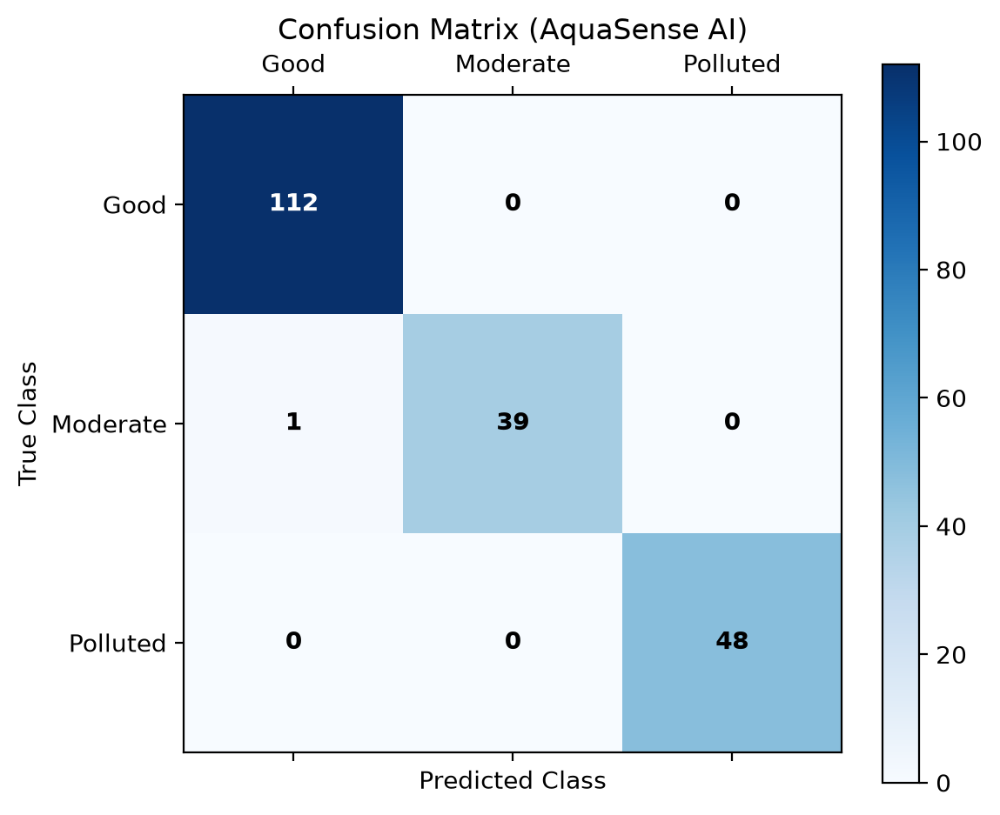
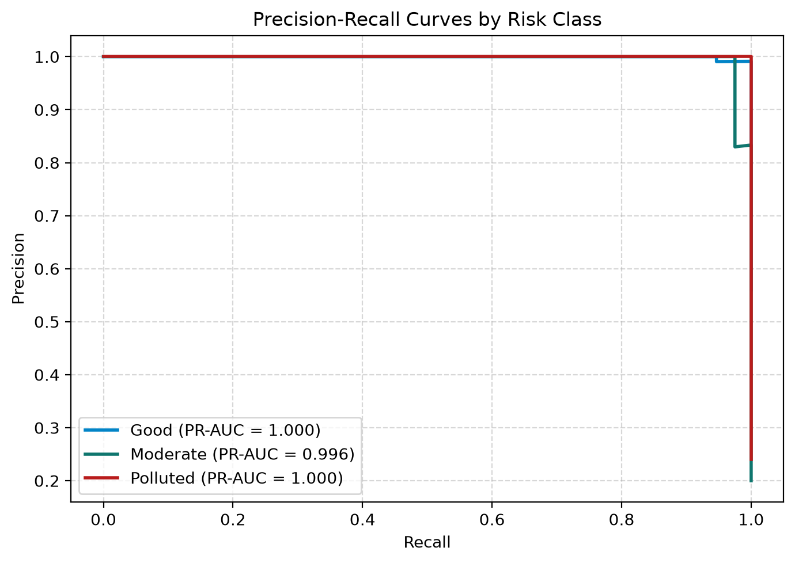
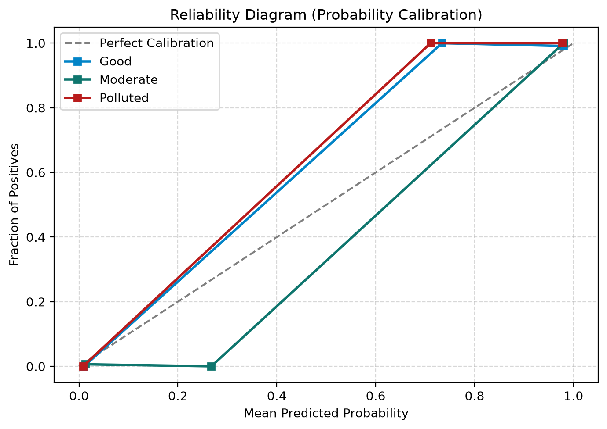
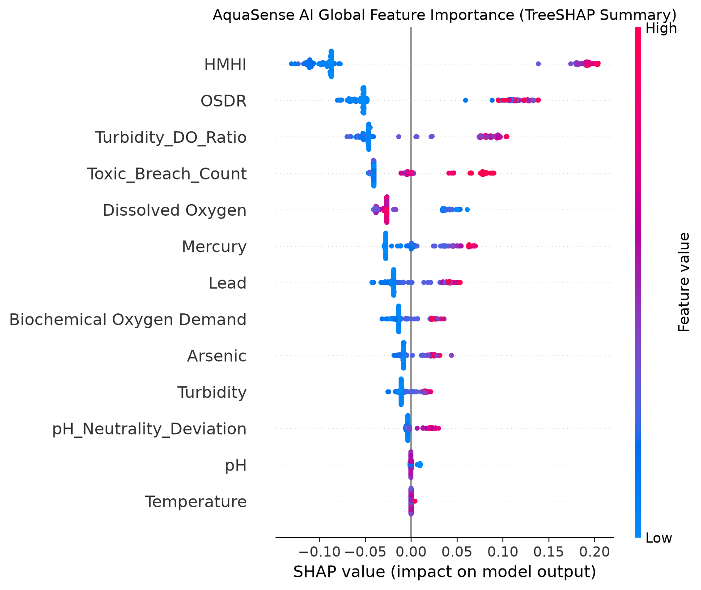
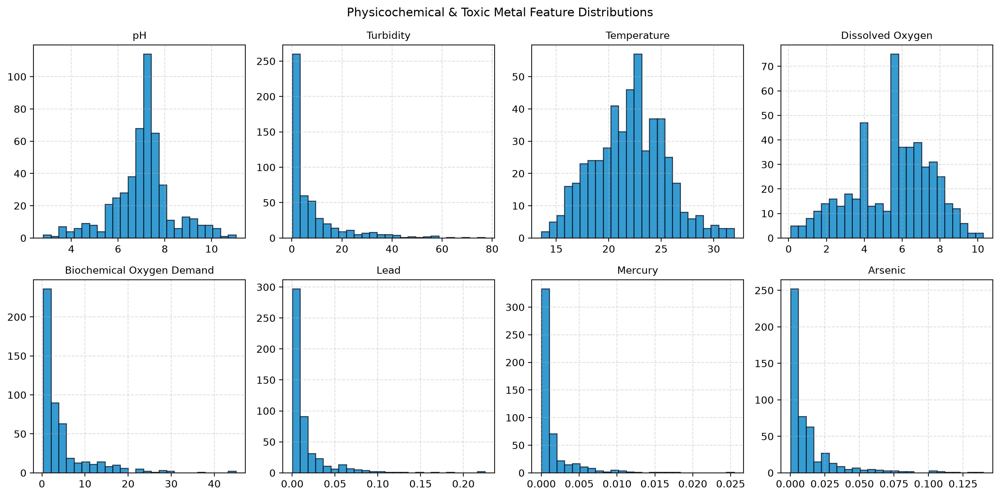
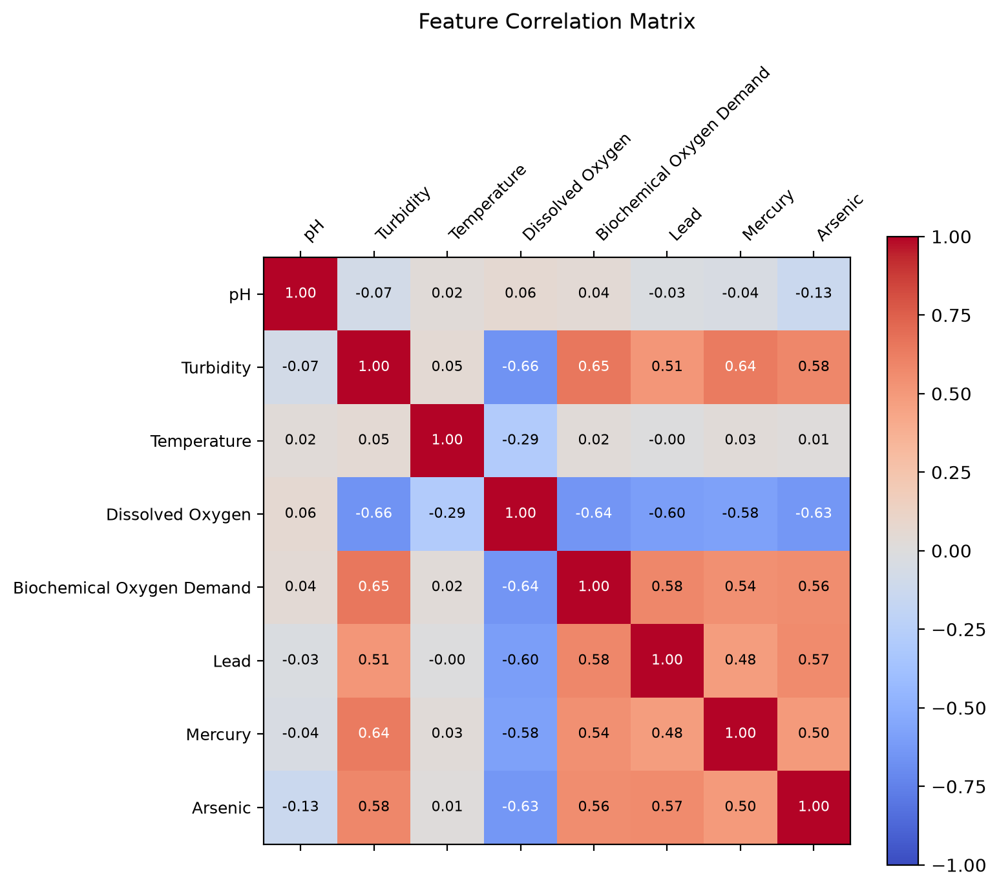

# AquaSense AI: Water-Quality Monitoring & Pollution-Risk Screening

Final-year AI/ML Senior Design Project. Predictions are screening support only and do not replace certified laboratory environmental analysis.

| Academic Details | Information |
| :--- | :--- |
| **Course** | Research Methodology (URP4201) |
| **Supervisor** | Dr. Alok Ku. Pani |
| **Authors** | Ayusman Das (2341004073) |
| | Selina Mohanty (2341013299) |
| | Rajana Durga Pavan Kumar (2341011099) |
| | Akanshaa Mohanta (2341013229) |
| **Repository** | https://github.com/DurgaPavan0923/AquaSenseAI.git |
| **Live Deployment** | https://aquasenseai-three.vercel.app/ |

## 1. Overview
AquaSense AI is an explainable environmental intelligence platform for water-quality screening and pollution-risk categorization. The system classifies multi-parameter water samples into three discrete risk tiers (Good, Moderate, Polluted), provides mathematically guaranteed inductive conformal uncertainty prediction sets, and computes local feature attributions using counterfactual occlusion against baseline training medians.

## 2. Problem Context
Standard laboratory testing for water quality (e.g., mass spectrometry, atomic absorption spectroscopy, and 5-day biochemical oxygen demand incubation) provides definitive measurements but requires days of turnaround time and specialized facilities. AquaSense AI acts as an upfront screening mechanism, triaging samples and flagging uncertain predictions with a mandatory notice: "Screening support only. Needs laboratory test."

## 3. Dataset & Leakage Audit
- **Source:** Kaggle (ziya07/water-quality-and-pollution-monitoring-dataset)
- **License Notice:** Raw CSV is excluded from Git to comply with distribution guidelines. Use `scripts/download_data.py` to retrieve data.
- **Audit Findings:** 1,000 observations, 10 columns, 0 missing values, 0 duplicate feature rows.
- **Class Counts:** Good (559), Moderate (198), Polluted (243).
- **Core Parameters:** pH, Turbidity (NTU), Temperature (deg C), Dissolved Oxygen (mg/L), Biochemical Oxygen Demand (mg/L), Lead (mg/L), Mercury (mg/L), Arsenic (mg/L).
- **Labeling Rule Audit:** Statistical inspection indicates that target labels in this benchmark dataset are derived from composite threshold intervals across the 8 physical and chemical parameters. The machine learning model learns to approximate and reproduce these underlying labeling rules with high mathematical fidelity rather than discovering unmeasured biochemical contaminants. Predictions serve strictly as screening support.

## 4. Statistically Disjoint 4-Way Partition Method
To prevent optimistic bias in probability calibration and inductive conformal quantile derivation, observations are partitioned into four strictly disjoint subsets:
- **Base Model Training (50%, 500 samples):** Fits feature scalers, domain ratios, and base tree ensemble structures.
- **Probability Calibration (15%, 150 samples):** Fits Platt scaling sigmoid calibrators using cross-validated probability outputs.
- **Conformal Calibration (15%, 150 samples):** Derives empirical non-conformity quantile (q_hat = 0.0230) on completely unseen data under exchangeability.
- **Independent Holdout Test (20%, 200 samples):** Unbiased final benchmark for empirical coverage, Macro-F1, and PR-AUC.

Pairwise disjointness is programmatically verified (0 shared identifiers, 0 duplicate feature vectors). Preprocessors and scalers are fitted exclusively on the base training partition.

## 5. Verified Experimental Results
Evaluated on the independent 200-sample holdout test partition:
- **Macro-F1:** 99.43% (0.9943)
- **Accuracy:** 99.50% (0.9950)
- **Weighted-F1:** 99.50% (0.9950)
- **Macro PR-AUC:** 0.9984
- **Multi-Class Brier Score:** 0.0122
- **Conformal Test Coverage:** 99.50% (at 90% target coverage, average set size 1.00)
- **Class-Conditional Coverage:** Good: 100.0%, Moderate: 97.5%, Polluted: 100.0%
- **Feature Rank Stability:** Spearman rank correlation rho = 0.9429 across 5 cross-validation folds

### Model Comparison Table (Holdout Test Partition)
| Architecture | Accuracy | Macro-F1 | Weighted-F1 | Macro PR-AUC | Brier Score |
| :--- | :--- | :--- | :--- | :--- | :--- |
| Dummy (Majority Class Baseline) | 0.5600 | 0.2393 | 0.4021 | 0.6667 | 0.8800 |
| Logistic Regression (Balanced Weights) | 0.9950 | 0.9943 | 0.9950 | 0.9960 | 0.0145 |
| Calibrated Random Forest (Active Deployed) | 0.9950 | 0.9943 | 0.9950 | 0.9984 | 0.0122 |
| XGBoost Classifier | 0.9750 | 0.9662 | 0.9752 | 0.9845 | 0.0446 |

### Diagnostic Visualizations

#### Confusion Matrix
Holdout test partition confusion matrix showing multi-class screening performance across Good, Moderate, and Polluted tiers.


#### Precision-Recall Curves
One-vs-Rest Precision-Recall curves across all three risk categories with macro-averaged PR-AUC of 0.9984.


#### Reliability Diagram (Probability Calibration)
Platt scaling calibration curves and multi-class Brier score (0.0122) demonstrating well-calibrated class probability estimates.


#### Global Feature Importance (TreeSHAP Summary)
TreeSHAP beeswarm distribution displaying the magnitude and directional impact of key parameters on water pollution risk categorization.


#### Feature Distributions
Univariate density distributions of physical, chemical, and heavy metal concentrations partitioned across risk tiers.


#### Correlation Heatmap
Spearman and Pearson correlation matrix illustrating relationships between physicochemical parameters and statutory ratio indicators.


## 6. Authoritative Water Quality Standards
Screening thresholds and sensor rules are cross-referenced against authoritative environmental criteria:
- **pH (6.50 - 8.50):** WHO 4th Ed. / BIS IS 10500:2012 / US EPA Secondary Standard. Below 6.5 accelerates pipe corrosion; above 8.5 impedes chlorination efficiency.
- **Turbidity (&le; 5.0 NTU):** WHO Guidelines / BIS IS 10500:2012. Suspended particles protect biological pathogens from disinfection.
- **Dissolved Oxygen (&ge; 6.50 mg/L):** CPCB Class A Surface Water / US EPA Freshwater Aquatic Life Criteria. Essential for aquatic life respiration and natural purification.
- **Biochemical Oxygen Demand (&le; 2.00 mg/L):** CPCB Class A Raw Water Source benchmark. Indicates organic enrichment, sewage, or agricultural runoff.
- **Lead (&le; 0.010 mg/L):** WHO Guideline / BIS IS 10500:2012 / US EPA Action Level (0.015 mg/L). Cumulative neurotoxin.
- **Mercury (&le; 0.001 mg/L):** BIS IS 10500:2012 / US EPA MCL (0.002 mg/L). Nephrotoxin and neurotoxin with bioaccumulative pathways.
- **Arsenic (&le; 0.010 mg/L):** WHO Provisional Guideline / BIS IS 10500:2012. Group 1 human carcinogen.

## 7. Web Platform & User Interface
- **Home (`web/index.html`):** Hero, dynamic verified metrics, interactive dashboard preview, capabilities, methodology, academic details.
- **Analysis Workspace (`web/analyze.html`):** 8 parameters structured into Physical, Chemical, and Heavy Metals sections. Sample ID, location, collection timestamp, tooltips, units, reset, illustrative sample buttons, CSV template download, and downloadable PDF assessment report.
- **Batch CSV Screening (`web/batch.html`):** Multi-sample CSV upload (up to 500 rows), missing value validation, risk distribution charts, traceable row records, downloadable CSV results, and printable batch reports.
- **Research & Metrics (`web/results.html`):** Verified metrics badges, benchmark comparison tables, 4-way partition breakdown, conformal diagnostics, and 6 diagnostic figures.
- **Monitoring Map (`web/monitoring.html`):** Interactive map with simulated regional monitoring stations, risk-tier color coding, location filters, and custom coordinate ingestion.
- **About & Method (`web/about.html`):** Academic context, labeling rule audit, 4-way partition design, statutory standards table, and scientific limitations.
- **Design System (`web/css/style.css`):** Solid neutral palette, water blue accent, deep navy typography, border radius <= 4px, zero emojis, zero em dashes, WCAG AA contrast.

## 8. Serverless API Architecture (< 150 MB Runtime Footprint)
- **FastAPI Entrypoint (`api/index.py`):** Endpoints `/health`, `/predict`, `/explain`, `/anomaly`, `/models`, and `/predict/batch`.
- **Runtime Dependencies:** Restricted strictly to `fastapi`, `pydantic`, `numpy`, `scikit-learn`, `joblib`.
- **Total Bundle Size:** 136.39 MB (well below 150 MB target and 250 MB ceiling).
- **Model Bundle Size:** 135.59 KB.

## 9. Setup and Reproduction
```bash
# 1. Install dependencies
pip install -r requirements-train.txt

# 2. Run data check and 4-way training pipeline
python scripts/download_data.py
python src/aquasense/train.py

# 3. Execute quality gates
python -m pytest
python scripts/lint_design.py
python scripts/check_bundle_size.py

# 4. Start local API server and preview
uvicorn api.index:app --port 8000
```

## 10. Research Hypotheses and Future Work
Hypotheses confirmed: inductive conformal prediction provides valid finite-sample marginal coverage guarantees (99.50% empirical at 90% target) under a 4-way disjoint experimental design, and domain-guided ratios enhance feature rank stability (Spearman rho = 0.9429) across cross-validation folds. Future work includes embedded low-power IoT microcontroller sensor deployment for automated in-situ monitoring.

## 11. Limitations and Responsible Use
Screening support only. Predictions do not replace certified environmental testing. Biological pathogens (e.g., Escherichia coli, Cryptosporidium) and unmonitored chemical contaminants require accredited laboratory verification.

## 12. License
Academic project license for course URP4201 Research Methodology.
